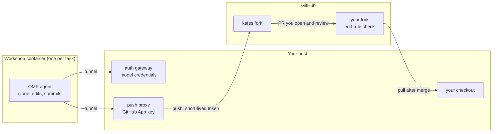

<div align="center">

# kafes

**A Workshop configuration that routes AI-generated code through GitHub review before it reaches your machine.**

[](https://www.gnu.org/licenses/gpl-3.0)


[Overview](#overview) · [How it works](#how-it-works) · [Installation](#installation) · [Usage](#usage) · [Security](#security) · [Contributing](#contributing) · [License](#license)

</div>

---

## Overview

kafes is a configuration, not a new sandbox. Isolation comes from Canonical
Workshop on LXD; without the GitHub path, a kafes task is a plain Workshop
container. What kafes adds is a **GitHub filter-through**: code an agent writes
leaves the container only as a pull request, and reaches your machine only
after an automated edit-rule check and your review in the browser. GitHub is
the speed bump.

kafes wires together:

- **Workshop:** one container per task, with an LXD network ACL and only two
  tunnels to the host
- **Host proxies:** an OMP auth gateway for model access and a push proxy for
  GitHub, so provider keys and GitHub credentials stay on the host; the
  container holds only revocable client tokens for the two proxies
- **GitHub:** a separate kafes fork the agent pushes to through a GitHub App,
  and a check workflow and ruleset on your fork that gate the merge

kafes doesn't make agent code safe. It makes sure every change is plain text
you have seen in a diff before it runs on your host.

---

## How it works



1. `kafes task create` launches a container and clones your fork into it.
2. Model requests go through the host's OMP auth gateway. Pushes go through a
   host proxy that authenticates them with one-hour GitHub App tokens, to a
   separate kafes fork.
3. `kafes task delete` revokes all credentials, removes the container and
   prints the PR link.
4. A `pull_request_target` check on your fork rejects anything but plain text
   on allowed paths. You merge only the commit that passed and was reviewed.
5. You pull the merged change into your checkout.

Full specification: [docs/design.md](docs/design.md).

---

## Installation

Requirements:

- Ubuntu with a systemd user session and `sudo`
- Rust 1.88+
- `git`, `curl`, `openssl`, `sha256sum`, `systemd-run`
- A public GitHub fork of each target repository

LXD, Workshop, [Bun](https://bun.sh/) and OMP are installed by `kafes init`
after confirmation.

```bash
git clone https://github.com/abuyukyi101198/kafes.git
cd kafes
cargo build --release
./target/release/kafes init
```

`init` installs the binary to `~/kafes/sandbox` (linked as
`~/.local/bin/kafes`) and walks through the one-time setup: a GitHub
organization and App, the LXD network ACL and the first repository. kafes never
writes to GitHub itself; it prints each step and verifies the result.

> [!WARNING]
> Docker's `FORWARD DROP` policy blocks the LXD bridge. See
> [Before you start](docs/usage.md#before-you-start).

---

## Usage

```bash
kafes repo add my-app --profile yarn       # once per repository
kafes task create my-app/feat/login        # task "feat-login"
kafes task shell feat-login                # run kafes-omp inside
kafes task delete feat-login               # revoke, remove, print review links
```

| Command                                                         | Purpose                                          |
|-----------------------------------------------------------------|--------------------------------------------------|
| `kafes init`                                                    | One-time host, organization and repository setup |
| `kafes repo add \| list \| show \| edit \| remove`              | Repositories and their profiles                  |
| `kafes task create \| list \| shell \| stop \| start \| delete` | Agent tasks                                      |
| `kafes teardown`                                                | Remove kafes from the host and GitHub            |

Global options: `--quiet`, `--verbose`, `--no-input`, `--no-color`. Tables go
to stdout, messages to stderr.

Each repository has a **profile** (`~/kafes/sandbox/repos/<repo>/profile.toml`)
that sets the workshop toolchain, the install command and the allowed paths.
The same rules drive the check and the agent's prompt.

Full guide: [docs/usage.md](docs/usage.md).

---

## Security

| Control         | Mechanism                                                                                                                           |
|-----------------|-------------------------------------------------------------------------------------------------------------------------------------|
| Isolation       | One Workshop container per task, removed on delete; LXD ACL blocks RFC 1918, CGNAT, link-local and ULA; exactly two tunnels allowed |
| Model access    | Revocable gateway token; provider credentials stay with the host's auth broker                                                      |
| GitHub access   | Host proxy holds the App key; one-hour tokens, one repository, `contents: write` only                                               |
| Host GitHub use | kafes reads GitHub anonymously and holds no user credentials                                                                        |
| Edit rules      | Path allowlist; rejects dotfiles, binaries, symlinks, mode changes, hidden characters, encoded blobs and foreign commits            |
| Merge           | Ruleset requires the check from GitHub Actions; merge only while the PR head is the commit `task delete` printed                    |
| Cleanup         | `task stop` and `task delete` revoke credentials; `task delete` does so first, even with damaged state                              |

Not covered: logic review, homoglyphs, code that passes review and runs during
QA. See [Residual risks](docs/design.md#residual-risks).

---

## Contributing

Contributions are welcome.

You can help by:

- Reporting bugs
- Verifying the [open items](docs/design.md#open-items) on your own setup
- Contributing presets for other ecosystems (npm, pnpm, Python and more)
- Improving documentation
- Submitting pull requests

Please open an issue before beginning significant work. Changes to the push
proxy, the edit-rule check or the isolation rules need a matching update to
the [design document](docs/design.md).

To report a security issue, use
[GitHub's private vulnerability reporting](https://github.com/abuyukyi101198/kafes/security/advisories/new)
rather than a public issue.

---

## License

kafes is licensed under the
[GNU General Public License v3.0 or later (GPL-3.0-or-later)](https://www.gnu.org/licenses/gpl-3.0.html).

You are free to use, study, modify, and redistribute kafes under the terms of
the GPL.

See the [LICENSE](LICENSE) file for the full license text.

