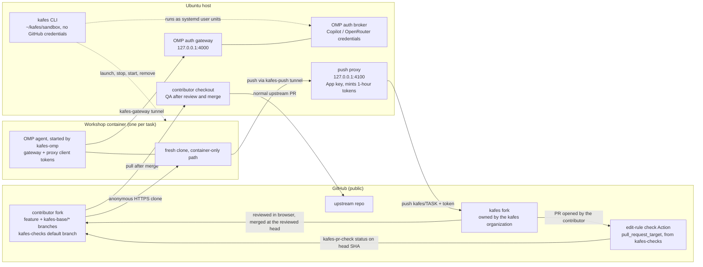
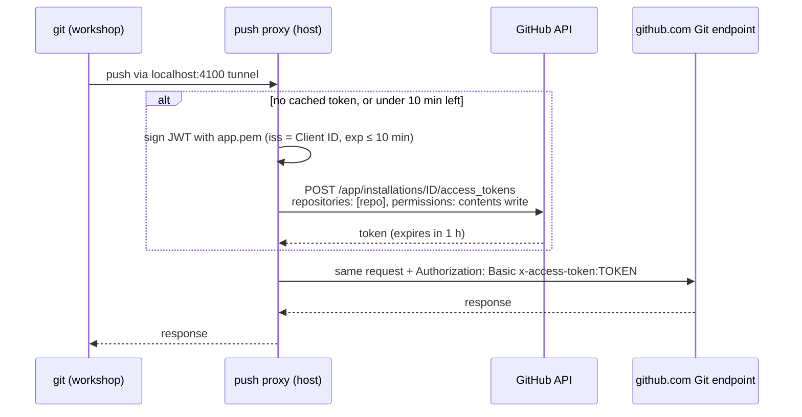

# Design

kafes runs OMP coding agents against an open-source repository so
their changes reach the contributor's host and fork only after review, as
plain text. This document is the specification: every rule kafes enforces,
and why. For installing and using kafes, see the [usage guide](usage.md); for
what has and hasn't been verified, see [Open items](#open-items).

Code: [`src/`](../src) (the CLI),
[`kafes-push-proxy.ts`](../assets/kafes-push-proxy.ts),
[`kafes-pr-check.yml`](../assets/kafes-pr-check.yml) (a template filled from
each repository's [profile](#profiles)) and the presets in
[`assets/profiles/`](../assets/profiles).

## Principles

- **The agent is an untrusted external contributor.** Its changes go through
  fork-and-PR review.
- **The agent stays in the workshop.** It clones, commits and pushes from
  there. Nothing reaches the contributor's host or fork before review.
- **Credentials stay on the host.** Host proxies add them to requests: the OMP
  auth gateway for model providers, the push proxy for GitHub. The workshop
  holds only revocable client credentials for those two proxies, replaced on
  every `task create` and `task start`.
- **kafes holds none of the contributor's GitHub credentials.** It reads
  GitHub anonymously and prints every write for the contributor to do, then
  checks the result.
- **Merges follow the review.** The contributor merges only the commit that
  passed the check and was reviewed. The browser merge can't pin it; see
  [Residual risks](#residual-risks).
- **Agent code reaches the host only after review and merge.** The check runs
  on GitHub; review happens in the browser. Host QA starts only once the
  reviewed commit is merged into the contributor fork.
- **Sessions are disposable.** Anything the agent could have touched is
  deleted or rewritten from a trusted copy, not cleaned up.

Placeholders: `<repo>` is the name of a repository added with
`kafes repo add`; `<task>` names one agent task; `<kafes-owner>` is the
organization that owns the kafes forks.

kafes handles several repositories. The organization, App, broker, gateway and
push proxy are shared; each repository has its own kafes fork, profile,
`kafes-checks` branch and ruleset. One task runs at a time, on one repository.

## Architecture

## Enforcement points

| Place                       | Controlled by                                                                                              |
|-----------------------------|------------------------------------------------------------------------------------------------------------|
| Workshop container          | The agent, during the task. Treated as untrusted.                                                          |
| kafes fork                  | The agent, through the push proxy, while the proxy runs. Treated as untrusted.                             |
| kafes CLI (host)            | The contributor only. Runs from `~/kafes/sandbox`, outside every agent-writable path.                      |
| Push proxy (host)           | The contributor only. Forwards Git requests; never stores or inspects pushed content.                      |
| Edit-rule check (GitHub)    | The contributor only. Workflow lives on the fork's `kafes-checks` default branch; the agent can't edit it. |
| Contributor fork / upstream | The contributor and the project's existing process                                                         |

## Edit-rule check

A GitHub Actions workflow on the contributor fork. `pull_request_target` runs
workflows from the base repository's default branch, never from the PR, so the
agent can't change the check. It also never lands on feature branches or in
upstream PRs.

### Setup

Per repository, during `kafes repo add`:

1. `kafes-checks` is a branch on the contributor fork containing only
   `.github/workflows/kafes-pr-check.yml`, rendered from the repository's
   [profile](#profiles). kafes builds it as a parentless commit with fixed
   metadata, so the same workflow file always gives the same commit; the
   contributor pushes it. When the profile's rules change, kafes shows the diff
   and the contributor force-pushes the replacement.
2. `kafes-checks` is the fork's default branch. Agent PRs target
   `kafes-base/<task>` branches cut from the feature branch; `kafes-checks` is
   never a PR base or head.
3. A ruleset on `kafes-base/**` requires the `kafes-pr-check` status from
   GitHub Actions, blocks deletion and force pushes, and has an empty bypass
   list. Status checks aren't required when a branch is created, so the
   contributor can push new `kafes-base/*` branches; merges into them still
   need the check.

> [!NOTE]
> The separate `kafes-checks` default branch exists because upstream
> repositories are assumed NOT to carry the check workflow, so the fork's usual default
> branch doesn't either. If the workflow exists upstream, the fork's default
> branch already holds it, and `main` (or whatever upstream uses) can remain the
> default branch. kafes's setup currently always uses `kafes-checks`.

### Workflow rules

| Rule                                                                                                                                                                                                | Why                                                                                                                                                                                                                 |
|-----------------------------------------------------------------------------------------------------------------------------------------------------------------------------------------------------|---------------------------------------------------------------------------------------------------------------------------------------------------------------------------------------------------------------------|
| Trigger: `pull_request_target` on `opened`, `synchronize` and `reopened`; the job runs only when the PR's head repository is `KAFES_FORK`. A kafes PR with any base other than `kafes-base/*` fails | kafes PRs always get a status, so a mis-targeted one is red. Other PRs, such as the `kafes-base → feature` merge, get none instead of a false failure; the ruleset still blocks a non-kafes PR into `kafes-base/**` |
| Permissions: `contents: read`, `statuses: write`; nothing else (workflow-level `permissions: {}`)                                                                                                   | `pull_request_target` gets a write-capable token; it is limited to what posting a status needs                                                                                                                      |
| Nothing from the PR is checked out or run. The diff and commit list are read through the API for `github.event.pull_request.head.sha`                                                               | The check treats agent content as data only                                                                                                                                                                         |
| PR-controlled text (title, branch, body, diff) never reaches `run:` through `${{ }}`; it is read from the event file or the API                                                                     | PR text can't inject commands                                                                                                                                                                                       |
| Agent-controlled text appears only as escaped printable ASCII, with a fixed prefix on every log line                                                                                                | Paths and emails can't spoof the summary or emit workflow commands                                                                                                                                                  |
| API errors, missing configuration, truncated commit lists and files without a textual diff fail the check; none of them passes it                                                                   | A check that can't see everything rejects the PR                                                                                                                                                                    |
| `kafes-pr-check` is posted as `success` or `failure` on the head SHA, with the failing rules in the description                                                                                     | Branch protection blocks the merge unless the current head passed                                                                                                                                                   |
| No secrets                                                                                                                                                                                          | Uses only the run's own `GITHUB_TOKEN`                                                                                                                                                                              |

## Push proxy

A small host program that holds the GitHub App's private key, mints
short-lived installation tokens and adds them to the agent's Git requests.
Forwarding and token minting are separate parts, each short enough to audit.

### One-time setup

1. **kafes organization.** Owns the kafes forks. An organization the
   contributor creates (default `<user>-kafes`), with no other members.
2. **kafes fork,** one per repository: the contributor fork, forked into that
   organization.
3. **GitHub App,** created under the kafes organization. Naming it after the
   organization makes the commit identity `<kafes-owner>[bot]`:
    - `Contents: read & write` only (`Metadata: read` is implied);
    - no `Workflows` permission, so pushes touching `.github/workflows/**` are
      refused;
    - no `Pull requests` permission;
    - webhook disabled; installable only on this account.
4. **Installation** on the kafes organization, selecting only the kafes forks.
   Each `kafes repo add` adds its fork to the installation.
5. **Private key,** generated in the App's settings (**Private keys → Generate
   a private key**). kafes moves the download to `~/.config/kafes/push/app.pem`,
   mode `600`, and deletes the original. It records the Client ID and
   installation ID.
6. **Workshop tunnel** `kafes-push` for `localhost:4100`, defined and connected
   like `kafes-gateway`.

Each proxy start serves one repository: the kafes fork of the task's
repository.

### Per request

### Proxy rules

| Rule                                                                                                                                                                                                | Why                                                                                                                                                     |
|-----------------------------------------------------------------------------------------------------------------------------------------------------------------------------------------------------|---------------------------------------------------------------------------------------------------------------------------------------------------------|
| Binds to `127.0.0.1:4100` only and requires a random bearer credential, compared in constant time, in addition to the `kafes-push` tunnel                                                           | Loopback alone does not authenticate local processes; only credential holders can use the proxy. Same-user host processes remain trusted.               |
| Forwards only `GET /<kafes-owner>/<repo>.git/info/refs?service=git-receive-pack\|git-upload-pack` and `POST /<kafes-owner>/<repo>.git/git-receive-pack\|git-upload-pack`; anything else gets `403`  | Git push and fetch for one repository; no REST API, no other repositories                                                                               |
| Requires `Host` to be `localhost:4100` or `127.0.0.1:4100`, refuses any request carrying `Origin`, and requires Git content types on `POST`                                                         | A web page in the contributor's browser can't push through the proxy                                                                                    |
| GitHub URLs are hard-coded. kafes runs it as a systemd user unit in `~/kafes/sandbox` with `bun --no-env-file --config=./bunfig.toml` (settings-free file), passing only identifiers and file paths | No `.env` or `bunfig.toml` preload from another directory can run with the key loaded                                                                   |
| Replaces any incoming `Authorization` header with its own                                                                                                                                           | The workshop can't choose which credential is used                                                                                                      |
| The proxy client credential lives in a mode-600 host file and a URL-scoped Git config inside the workshop; a new one is created on every proxy start and deleted when the proxy stops               | Git sends it only to the local proxy, not to GitHub. It is not a GitHub installation token.                                                             |
| Each token is requested for the one repository with `contents: write` only, even if the App later gains permissions                                                                                 | The token is never broader than this design needs                                                                                                       |
| Tokens stay in memory only; neither they nor request bodies are logged                                                                                                                              | Tokens and agent code don't land on the host disk                                                                                                       |
| Pushed content is never inspected or unpacked                                                                                                                                                       | Unpacking would put agent code on the host before review. The edit rules run on GitHub.                                                                 |
| Every unexpired minted token is retained, including predecessors after refresh; on shutdown, the proxy stops serving, aborts forwarding, awaits pending minting and revokes all tracked tokens      | Rotation and shutdown races can't silently lose revocable tokens. Revocation is best effort; failures are logged and exit nonzero, which kafes reports. |
| Forwarding is limited to four concurrent requests with five-minute total deadlines, including streaming; each mint or revoke is bounded to 15 seconds, and API redirects are rejected               | Resource use and cleanup time stay bounded; upstream requests are cancelled on client disconnect or shutdown.                                           |
| Stopped by `kafes task stop` and `kafes task delete`, before review starts                                                                                                                          | The agent can't push while its changes are being reviewed                                                                                               |

## Local rules: Workshop container

| Rule                                                                                                                                                                                                                                                                                                                                                                | Why                                                                                                                                                                                             |
|---------------------------------------------------------------------------------------------------------------------------------------------------------------------------------------------------------------------------------------------------------------------------------------------------------------------------------------------------------------------|-------------------------------------------------------------------------------------------------------------------------------------------------------------------------------------------------|
| One workshop per task, launched from a trusted definition rendered on the host from the repository's profile; `workshop remove` when the task is deleted                                                                                                                                                                                                            | Edits to OMP config, the launcher or the definition can't persist into the next task                                                                                                            |
| kafes never runs `workshop refresh` or `workshop restore` on a task workshop. `kafes task stop` and `task start` use only `workshop stop` and `start`; `start` first replaces the launch directory's `.workshop/dev.yaml` with the trusted copy, refusing a symlinked `.workshop`                                                                                   | A refresh or restore would apply an agent-edited definition or reconnect removed plugs                                                                                                          |
| Workshops launch from `~/kafes/tasks/<task>`, which holds only `.workshop/dev.yaml`. kafes runs every `workshop` command directly, without a shell, with that directory as its working directory, and refuses to run from inside `~/kafes/tasks`. The directory is not opened in an IDE or file manager                                                             | The directory is mounted read-write at `/project`, so the agent can plant files there (for example a `.git/` with `core.fsmonitor`, or an `.envrc`). Prompts and shell hooks then never see it. |
| After launch, kafes disconnects the Node SDK's package caches. After launch and after every start, it requires exactly two connections, the `kafes-gateway` and `kafes-push` tunnels; any other connection, or an output line it can't parse, stops it                                                                                                              | No cache carries state between tasks, and no other plug reaches the host                                                                                                                        |
| The clone lives in `/home/workshop/src/<repo>`, not `/project`                                                                                                                                                                                                                                                                                                      | The agent's work stays inside the container; nothing it writes there reaches the host disk                                                                                                      |
| The container can't reach the host or private networks: the `kafes-no-lan` LXD ACL on the Workshop bridge rejects RFC 1918, CGNAT, link-local and IPv6 ULA ranges. Before each launch or start, kafes checks the ACL is still attached, then that the container's address is on that bridge                                                                         | The only routes to the host are the two tunnels                                                                                                                                                 |
| The clone is anonymous, over HTTPS from the contributor's public fork                                                                                                                                                                                                                                                                                               | Cloning needs no credentials                                                                                                                                                                    |
| Push remote `kafes` is `http://localhost:4100/<kafes-owner>/<repo>.git`                                                                                                                                                                                                                                                                                             | Pushes go through the push proxy                                                                                                                                                                |
| Gateway client token, new on every `task create` and `task start`, granting only the providers the gateway serves out of Copilot, OpenRouter and those the copied settings use; removed from `clients.json` by `task stop` and `task delete`                                                                                                                        | It can spend model quota. It can't reveal provider credentials.                                                                                                                                 |
| No GitHub credential of any kind: no tokens, credential helper, `gh auth` or SSH keys                                                                                                                                                                                                                                                                               | Nothing in the workshop can reach GitHub as anyone                                                                                                                                              |
| Host OMP settings copied only from an allowlist (model roles, presets, fallbacks, thinking, compaction except remote endpoints, display). Credentials, any `!command` value, tool, approval, bash and eval settings, extensions, discovery sources and path-scoped entries stay on the host                                                                         | The agent gets the contributor's model setup, not their policy, credentials or host paths                                                                                                       |
| The agent starts only through `kafes-omp`: `--approval-mode always-ask`, the tools `read,grep,glob,edit,write,bash`, the `kafes-policy.yml` overlay (eval, subagents, browser and LSP denied) and the kafes prompt, which states the profile's path rules. `task shell` and `task start` rewrite the launcher, policy, prompt and settings from the host before use | Edits and shell commands need the contributor's approval, and agent edits to those files don't outlive the terminal                                                                             |
| Agent pushes only `kafes/<task>` branches                                                                                                                                                                                                                                                                                                                           | Convention that keeps one branch per task; not enforced                                                                                                                                         |
| Agent commits as the App bot's noreply identity (`<id>+<kafes-owner>[bot]@users.noreply.github.com`)                                                                                                                                                                                                                                                                | Marks commits as agent-made by convention. The check verifies the email is consistent, not who wrote the code. CLA handling is [TBD](#open-items).                                              |

## Local rules: host

| Rule                                                                                                                                                                                    | Why                                                                                           |
|-----------------------------------------------------------------------------------------------------------------------------------------------------------------------------------------|-----------------------------------------------------------------------------------------------|
| kafes runs from `~/kafes/sandbox` (linked as `~/.local/bin/kafes`), the binary copied there by `kafes init`                                                                             | The program that controls the cage stays outside every agent-writable path                    |
| Configuration, profiles and task records live only under `~/kafes/sandbox`, never in a task directory or workshop; a task records its repository from `task create` until `task delete` | Nothing the agent can write decides how kafes builds, checks or cleans up a task              |
| kafes reads GitHub only with anonymous Git (no credential helper, no prompt) and the public API, prints each write for the contributor, then checks the result                          | A bug or compromise in kafes can't write to GitHub as the contributor                         |
| Broker, gateway and push proxy run as systemd user units bound to loopback, never with `--no-auth`                                                                                      | Provider credentials stay on the host                                                         |
| Push proxy follows the [proxy rules](#proxy-rules); `app.pem` stays on the host, mode `600`                                                                                             | GitHub credentials stay on the host                                                           |
| If `task create` or `task start` stops part-way, or is interrupted, it prints the kafes command that cleans up                                                                          | Services and credentials are never left behind silently                                       |
| Every `sudo` call in `task create` and `task start` happens first, before anything is started                                                                                           | An authentication prompt can't leave a half-built task                                        |
| Agent commits are never fetched, cloned or checked out on the host before merge, and the edit rules don't run on the host                                                               | Agent content doesn't pass through host tooling before review                                 |
| Review happens in the browser once `kafes-pr-check` has passed on the PR's current head; the merge happens only while that head is still the commit `kafes task delete` printed         | The check and the review cover the same commit, and nothing pushed later is merged unreviewed |
| QA on the host happens only after review and merge: `kafes-base/<task>` is merged into the feature branch and pulled, then installed and tested as usual                                | Host execution of agent code happens only on reviewed, merged code                            |

## GitHub rules

| Where                      | Rule                                                                                                                                                                                                                                |
|----------------------------|-------------------------------------------------------------------------------------------------------------------------------------------------------------------------------------------------------------------------------------|
| kafes organization         | One per contributor, owned by the contributor, with no other members. No membership in the project's org. No write access to anything except its own forks.                                                                         |
| GitHub App                 | Permissions as in [One-time setup](#one-time-setup); installed only on the kafes forks. Private key only on the host.                                                                                                               |
| kafes forks                | One per repository. Public, so kafes reads them anonymously. Actions disabled. No secrets, deploy keys, webhooks, or apps other than the push App.                                                                                  |
| kafes PR                   | Opened by the contributor from `kafes/<task>` to `kafes-base/<task>`, reviewed in the browser                                                                                                                                       |
| Contributor fork, Actions  | Fork-PR workflow runs get no secrets and a read-only token. The only `pull_request_target` workflow is the edit-rule check, which never checks out PR code. Whether an approval click gates kafes PRs is [unverified](#open-items). |
| Contributor fork, branches | Public. Default branch is `kafes-checks`, holding only the check workflow. kafes PRs target `kafes-base/*` branches, protected by the ruleset from [Setup](#setup).                                                                 |
| Upstream                   | The contributor's normal PR. Agent-made commits keep the kafes identity; CLA handling is [TBD](#open-items).                                                                                                                        |

## Profiles

Each repository has a profile, `~/kafes/sandbox/repos/<repo>/profile.toml`,
which describes it to kafes in one place:

| Section    | Sets                                                                                      | Used in                                                  |
|------------|-------------------------------------------------------------------------------------------|----------------------------------------------------------|
| `workshop` | The Node SDK channel, apt packages and setup commands                                     | The workshop definition and setup, on `task create`      |
| `project`  | The install command, its environment, and a hint on how to run tests                      | The clone's install on `task create`; the agent's prompt |
| `rules`    | `allowed`, `rejected` and `review_closely` path patterns (JavaScript regular expressions) | The edit-rule check and the agent's prompt               |

The check and the prompt are rendered from the same rules, so the agent is told
exactly what the check enforces.

- **Presets, copied.** kafes ships presets (so far `yarn`). `repo add` copies
  the chosen preset; updating kafes never changes a saved profile, so the rules
  in force change only when the contributor changes them.
- **Changed on the host only.** `kafes repo edit` edits the profile in the
  contributor's editor, or replaces it with a preset, and validates it. A
  changed check reaches GitHub only when the contributor force-pushes the new
  `kafes-checks` commit kafes prepares.
- **Validated.** Unknown keys, invalid package or variable names, empty
  patterns, an empty `allowed` list and `${{` in a pattern are refused. The
  check compiles every pattern and fails on an invalid one.
- **Fixed rules stay.** The [content rules](#content-rules-any-path) are part
  of the check itself; a profile can't relax them.

## Edit rules

The [edit-rule check](#edit-rule-check) applies these to the PR's head diff
and commit list. Any failure sets a failing status, which blocks the merge.

### Path rules

From the repository's [profile](#profiles):

| Rule             | Effect                                                                                                          |
|------------------|-----------------------------------------------------------------------------------------------------------------|
| `allowed`        | An allowlist: a change to any other path fails, so tooling, scripts and dependency files need a human commit    |
| `rejected`       | Fails even inside `allowed`, for example generated code                                                         |
| `review_closely` | Passes, but the summary lists it for line-by-line review: files every test run loads, or that later agents read |

The `yarn` preset, [`assets/profiles/yarn.toml`](../assets/profiles/yarn.toml),
is an example.

### Content rules (any path)

| Reject                                                              | Detected by                                                                                                                                                                      |
|---------------------------------------------------------------------|----------------------------------------------------------------------------------------------------------------------------------------------------------------------------------|
| Dotfiles and dot-directories, even inside allowed paths             | Path scan, including the old path of renames                                                                                                                                     |
| Binary files                                                        | Files without a textual patch in the compare API, and `Binary files`/`GIT binary patch` lines in the full diff                                                                   |
| Mode changes, executable bits, symlinks, submodules                 | Any mode other than `100644` in the full diff's headers (`new file mode`, `old mode`/`new mode`, `index … <mode>`); reported as "file mode … (executable, symlink or submodule)" |
| Bidirectional, zero-width or control characters on added lines      | Character scan of added lines, including Unicode tag characters                                                                                                                  |
| Long encoded-looking runs (e.g. over 200 base64/hex characters)     | Pattern scan of added lines                                                                                                                                                      |
| Files or lines too large for GitHub to show inline                  | At most 99 files, 1000 changed lines per file and 500 characters per added line. GitHub's exact collapse thresholds are unconfirmed.                                             |
| Paths with characters outside `A-Z a-z 0-9 . _ @ + , [ ] / -`       | Path scan, including the old path of renames                                                                                                                                     |
| Merge commits, or commits by an identity other than the kafes bot's | The compare API's commit list: parent counts, author and committer emails                                                                                                        |
| A PR whose base isn't a `kafes-base/*` branch                       | The event payload's base ref                                                                                                                                                     |

## Residual risks

- **Logic review.** The rules guarantee every change is plain text visible in
  GitHub's diff, not that it's correct or benign.
- **Reviewed code during QA.** QA runs on the host with the contributor's
  credentials, so a backdoor that passes review runs there. It's the same
  trust as testing a colleague's PR, but review is the only control on test
  files, which run as code.
- **Dependency changes.** Made by a human, as separate commits.
- **Exfiltration of project data.** The project is public. The agent can reach
  the internet, but not the host or private networks.
- **Look-alike characters.** Homoglyphs (e.g. Cyrillic `а` for Latin `a`)
  aren't detected. A blanket non-ASCII ban would reject legitimate text in
  many repositories.
- **Fork CI before review.** The fork's `pull_request` workflows can run agent
  code on GitHub-hosted runners before review, with a read-only token and no
  secrets.
- **Workshop control socket.** Probably reachable inside the container (unverified); the definition holds no secrets.
- **Gateway token.** Spends model quota while the task runs.
- **Proxy client token.** Grants the agent's Git access while the proxy runs.
  Any process running as the contributor's host user can read it and the App
  key: the proxy is not a same-user isolation boundary.
- **Best-effort revocation.** Network failures, lost mint responses, crashes
  and forced kills can leave installation tokens valid for up to an hour.
  Stopping the proxy ends forwarding, but doesn't guarantee revocation; kafes
  warns when the proxy reports a failed revocation.
- **Merge without a pinned head.** The browser merge has no
  `--match-head-commit`; the reviewer compares the PR head with the commit
  `kafes task delete` printed. A token that failed to revoke could still push in
  that window. GitHub probably rejects a merge whose head changed after the
  page loaded (unverified).
- **Agent files within one terminal.** The agent can edit `kafes-omp`, its
  policy, prompt and settings during a session. kafes rewrites them on
  `task shell` and `task start`, but restarting `kafes-omp` in the same
  terminal loads the edited copies. Plain `omp` in the workshop runs with OMP's
  defaults, which approve every tool call.
- **Pushes during a session.** While the proxy runs, the agent can push
  anything to any branch of its fork. Nothing reaches the contributor fork
  without the check and a reviewed merge. Forks share an object store, so a
  pushed commit is also reachable by SHA under the upstream URL, with a "does
  not belong to any branch" banner: a phishing risk, not a code path.
- **Check workflow token.** `pull_request_target` gets a write-capable token,
  limited by `permissions:` to posting statuses. A bug that ran PR content or
  put PR text in a shell step would hand it to the agent; the workflow is
  small so that changes to `kafes-checks` stay reviewable.
- **App private key.** Long-lived, and mints tokens for every repository the
  App is installed on; the installation covers only the kafes forks. A
  compromised host means the key needs rotating.
- **Profile rules.** The path rules are only as strict as the profile. A broad
  `allowed` pattern lets the agent change build or test tooling that runs on
  the host during QA; a preset or a profile edit carries the same weight as
  code.
- **Workshop environment.** Whether `workshop exec` passes host environment
  variables into the workshop is unverified; kafes sets only the variables it
  needs.

## Open items

- **TBD: CLA and authorship.** CLA checks typically read each commit's author
  email and linked login. App-bot commits carry a `[bot]` identity, which such
  checks often exempt as automation. Whether that is honest attribution for
  agent-written code is for each project's maintainers to decide.
- **Push proxy against GitHub.** Confirmed on a Linux host by the
  verify stage of `repo add`: the proxy starts, mints an App token, and serves
  an authenticated `git ls-remote` of the kafes fork from the host. Pushes, the
  concurrency limit, streaming cancellation, token rotation and shutdown have
  run only against a local stand-in or not at all. Unconfirmed:
    - A push through the proxy with `x-access-token` Basic auth succeeds.
    - A push changing `.github/workflows/**` is refused.
    - Requests for any other repository or path get `403`.
    - A large push through the Workshop tunnel doesn't time out.
    - `DELETE /installation/token` revokes the current token.
    - URL-scoped proxy authentication works through the Workshop tunnel, and
      unauthenticated requests are refused.
    - Shutdown cancels active transfers and revokes tokens minted before and
      during shutdown; simulated network failures produce a nonzero exit.
- **Edit-rule check on GitHub.** Confirmed on a Linux host: GitHub
  Actions becomes the required-status source after the dummy PR, and the rules
  API reports the ruleset as kafes requires (`integration_id` 15368,
  `do_not_enforce_on_create`), since the ruleset check in `repo add` passed.
  The rules themselves have run only against fixtures and a local stand-in
  API. Unconfirmed:
    - A `pull_request_target` run triggers when the contributor opens the PR,
      without an approval click.
    - A status posted with the run's `GITHUB_TOKEN` satisfies the required-status
      rule.
    - The compare API between the base commit and a kafes-fork head commit works
      from the contributor fork's side.
    - The real API's output for binary files, mode changes and large diffs
      matches what the check expects.
    - With the required status pinned to GitHub Actions and an empty bypass
      list, the admin can't merge past it.
    - The `yarn` preset's allowlist doesn't reject paths ordinary agent work needs.
- **Workshop isolation.** Confirmed on a Linux host:
  `workshop connections` output, cache-plug disconnection, the two tunnels
  connecting and the container's address on the ACL bridge. Unconfirmed:
    - The `kafes-no-lan` ACL blocks the host and private ranges, and still allows
      the two tunnels and internet egress.
    - `workshop stop` and `start` keep the caches disconnected and the files,
      sessions and packages in place.
    - Whether `workshop remove`, `connect`, `connections` or `start` re-read an
      agent-edited `.workshop/dev.yaml` from the launch directory.
    - Copied host settings route through `pi-native` for providers other than
      Copilot and OpenRouter.
- **CI approval gate.** GitHub's approval setting for outside
  collaborators may depend on who triggers the run. The contributor opens
  kafes PRs, so it may never apply. Runs still get no secrets and a read-only
  token.
